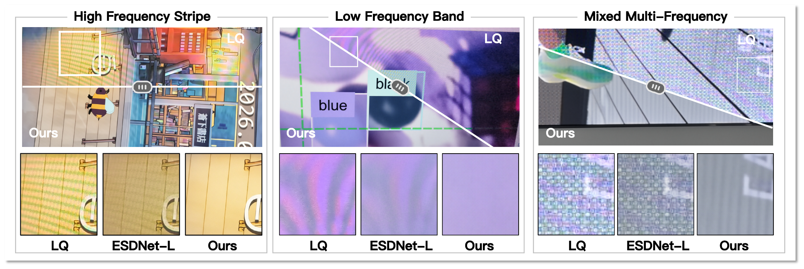
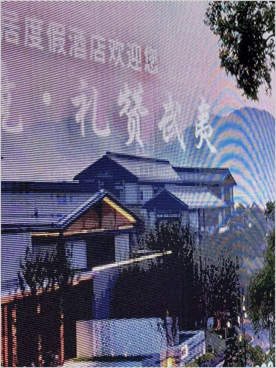
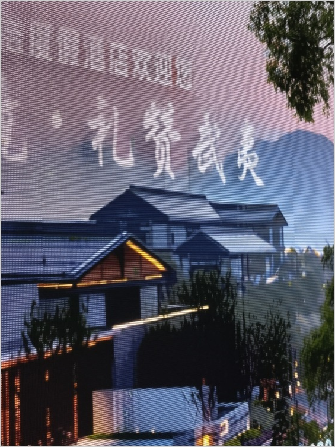
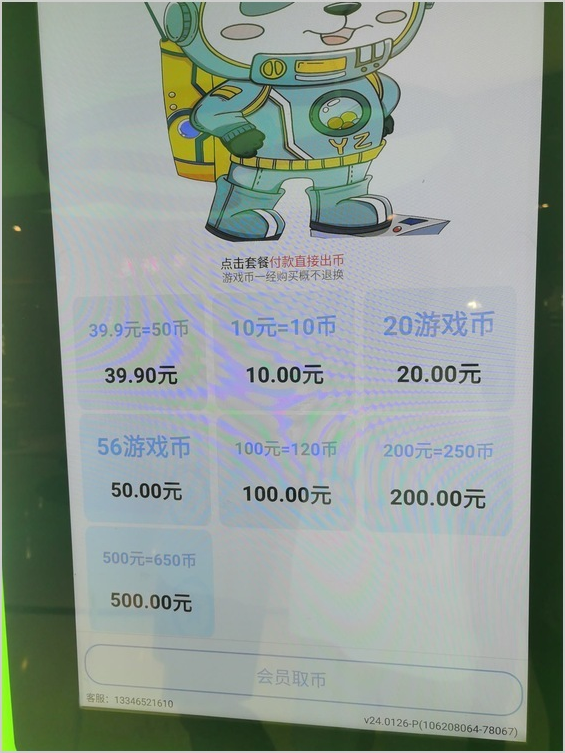
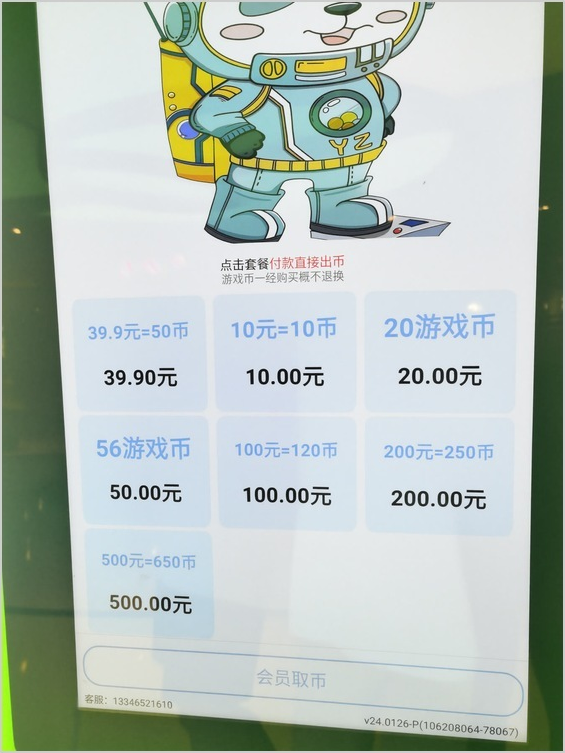
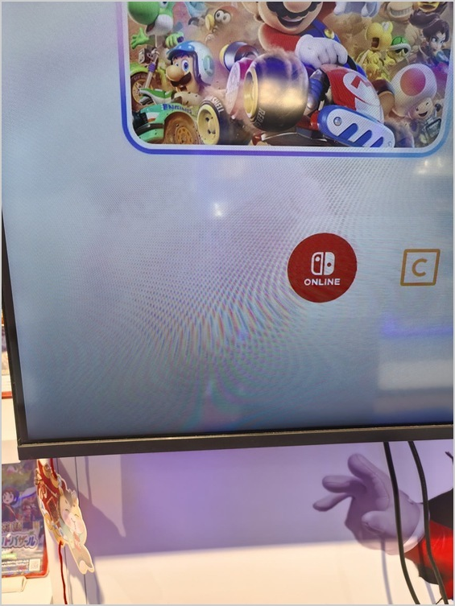
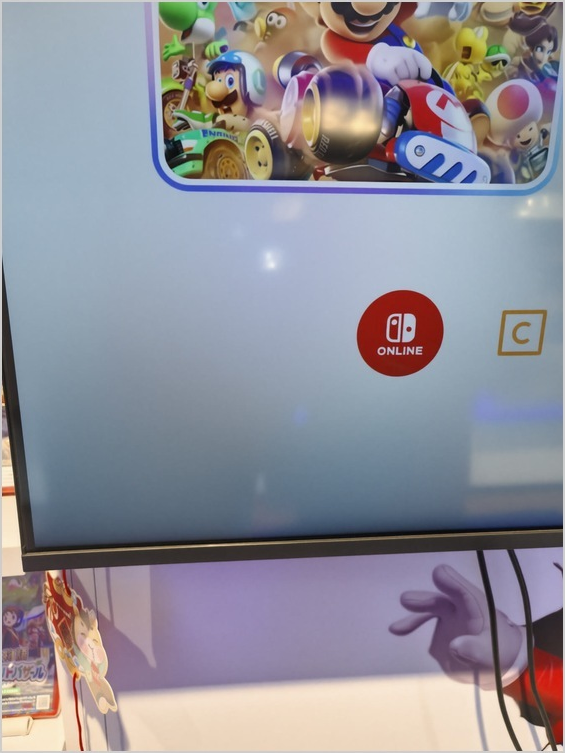

<div align="center">

# DemoiréEdit

### Dual-Scale Condition-Shift Editing for Robust Real-World Image Demoiréing

[](https://arxiv.org/abs/2610.26644)
[](https://clausy9.github.io/DemoireEdit/)
[](https://huggingface.co/umu/DemoireEdit)
[](https://huggingface.co/datasets/umu/DailyMoire130)

</div>

<p align="center"></p>

Dual-Scale Condition-Shift Editing approaches image demoiréing through image editing. A global restoration stage suppresses moiré at reduced resolution; a second stage restores at the input resolution while shifting its image condition from the global result to the original capture.

## Highlights

- **Restore globally, refine locally.** Two image scales connect scene-level restoration with input-resolution editing.
- **Shift the condition during restoration.** The second stage begins with the globally restored image and returns to the original capture for later steps.
- **Run and study the pipeline.** Inference, an interactive demo, paired-data training and reproducible configurations are included.
- **Study everyday display captures.** DailyMoiré130 provides 130 original-resolution screen photographs for unpaired real-world evaluation.

## Visual results

| Scene | Input | Our method |
| :--- | :---: | :---: |
| Architectural signage |  |  |
| Illustrated display |  |  |
| Game display |  |  |

Qualitative examples from **Figure 8 of the paper**, shown as input/result pairs. These are historical paper outputs, not new executions of this repository. The figures have no aligned ground truth and do not establish universal quality. See the [interactive comparisons](https://clausy9.github.io/DemoireEdit/#results) and [asset provenance](provenance/qualitative-examples.json).

## DailyMoiré130 dataset

[Download DailyMoiré130 on Hugging Face](https://huggingface.co/datasets/umu/DailyMoire130): **130 original-resolution screen photographs**, one `test` split, and no aligned clean targets. The release includes a per-image SHA-256 manifest and an evaluation protocol.

The public derivative has local blur in 18 images; the other 112 retain their scene pixels. Image dimensions, source color profiles, and pixels outside blur regions are preserved. Consult the dataset card for processing details and terms, and pin a dataset revision when reporting results. Historical paper scores are not a new evaluation of this derivative.

## Documentation

- [Getting started](docs/installation.md)
- [Inference](docs/inference.md)
- [Training](docs/training.md)
- [Models](docs/models.md)

## Getting started

The reference environment is Linux, Python 3.11 and an NVIDIA GPU. From the repository root:

```bash
python3.11 -m venv .venv
source .venv/bin/activate
python -m pip install --require-hashes -r requirements-demo-linux-cu128-py311.txt
python -m pip install --no-deps -e .
python scripts/download_base_models.py --output weights/base
```

Prepare the restoration weights as described in [Models](docs/models.md), then run:

```bash
export DIFFSYNTH_MODEL_BASE_PATH=weights/base
export DIFFSYNTH_SKIP_DOWNLOAD=true
python scripts/download_adapter.py --output weights
export DEMOIRE_EDIT_WEIGHTS_PATH=weights/demoireedit.safetensors

demoire-infer --input path/to/image.png --output outputs/restored.png
```

For the interactive interface:

```bash
demoire-demo --port 7860
```

Open `http://127.0.0.1:7860`. See [Installation](docs/installation.md) for environment details and [Inference](docs/inference.md) for remote access and runtime options. The restoration adapter is available on [Hugging Face](https://huggingface.co/umu/DemoireEdit).

## Method

1. **Global restoration.** Edit a reduced-resolution version of the capture to obtain a global restoration reference.
2. **Condition shift.** Start a second editing trajectory at the input resolution. Use the global result for the early denoising steps, then switch to the original capture.
3. **Decode.** Produce the restored image at the original dimensions.

The default sampler uses ten steps in each stage and switches the second-stage condition after its third step. The exact configuration is in [configs/paper.json](configs/paper.json).

## Training and evaluation

[Training](docs/training.md) describes paired-data preparation, the maintained loss recipe and distributed launch. [Evaluation](docs/evaluation.md) separates image-quality evaluation from the available integration checks. [Reproducibility](docs/reproducibility.md) records the tested environment, settings and known limits. The model card documents the supplied weight's provenance separately from the maintained training recipe.

## Repository structure

```text
assets/          Original paper teaser
configs/         Method settings and pinned model inventory
recipes/         Local environment and paired-data examples
src/demoire_edit/     Inference, demo, training and condition scheduling
src/diffsynth/   Model and diffusion backend
scripts/         Downloads, model validation and source packaging
tests/           Scheduling, objective and offline-loading checks
docs/            Setup, training, evaluation and reproducibility
provenance/      Model digests and validation receipts
site/            Project page with interactive visual comparison
```

For development, see [CONTRIBUTING.md](CONTRIBUTING.md). Run the CPU checks with `python -m unittest discover -s tests -v` after installing the package.

## Acknowledgements and license

We build on the image-editing and diffusion tooling credited in [NOTICE](NOTICE) and the [model card](docs/model-card.md). Source code is licensed under [Apache-2.0](LICENSE). Models, images and datasets retain their own terms; their redistribution is reviewed separately.
